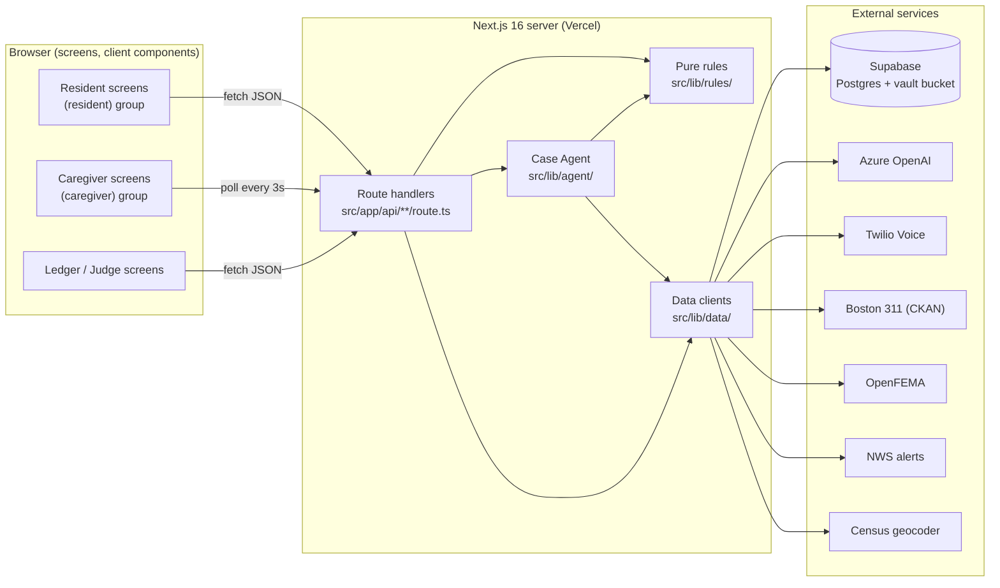

# Design Document

## Overview

Threshold is a single mobile-first, installable Next.js 16 (App Router) web app deployed as one Vercel project. Disabled Boston residents and their caregivers use it to turn every barrier (a blocked or broken sidewalk, a storm, a shelter refusal, an aid denial) into a documented, routed, and tracked record. The core idea is "one profile, three moments": what a resident records in the Proof Vault before a disaster becomes the evidence used after it.

Two architectural rules shape everything. First, the browser never talks to Supabase or any third party directly; all database, storage, and secret-bearing external calls happen only in Next.js server route handlers under `src/app/api/` using `SUPABASE_SERVICE_ROLE_KEY`. Second, all decision logic (routing, clocks, FEMA matching, check-in escalation, eligibility wording, distance, privacy filtering) lives in `src/lib/rules/` as pure functions with no I/O so it can be property-tested with fast-check. The design maps every requirement from `requirements.md` (the source of truth) to a concrete handler, pure function, or component.

## Architecture



**Hard boundary (Req 22.4, 22.5):** the browser only ever calls Next route handlers. It never calls Supabase, Azure, Twilio, or any data source directly. Secrets are read only in server code. The only `NEXT_PUBLIC_*` values permitted in browser responses are `NEXT_PUBLIC_SUPABASE_URL` and `NEXT_PUBLIC_SUPABASE_ANON_KEY`; these are not treated as a secret exposure.

**Deploy target:** one Vercel project. Env vars are configured in Vercel as server-only secrets. The ~4.5 MB request body limit drives browser-side photo resize (Req 3.1).

### Next.js 16 conventions (version 16.4.3, confirmed from `node_modules/next/dist/docs`)

- Route handlers are `route.ts` files under `src/app/api/` using the Web `Request`/`Response` model: `export async function GET/POST(request: NextRequest)`, returning `Response.json(...)`.
- Dynamic route params are a `Promise` and MUST be awaited. Example: `export async function GET(request: NextRequest, ctx: RouteContext<'/api/case/[id]'>) { const { id } = await ctx.params }`.
- Page and layout `params`/`searchParams` props are also a `Promise`: `await params` in a server component, `use(params)` in a client component.
- Screens are grouped with route groups `(resident)` and `(caregiver)` per the structure steering; they do not affect the URL path.

## Project structure

```text
src/app/
  (resident)/        home, vault, report, case/[id], rights, claim, letter, go-card
  (caregiver)/       status, cases
  ledger/            city aggregate view
  judge/             Judge Mode: seed, replays, fast-forward
  api/               route handlers (the only data/secret boundary)
src/lib/
  rules/             pure functions only: routing, clocks, fema-match, checkin-chain, distance, eligibility, privacy
  agent/             Case Agent: loop, tools, trace
  rights/            library.json (rights data with source URLs)
  data/              clients: boston311, openfema, nws, geocoder, supabase, twilio, azure
src/components/      shared accessible UI components (PascalCase, one per file)
fixtures/            replay data: blizzard alert, dr-4780.json
tests/               vitest unit + property tests; playwright a11y; tests/evals/case-agent/ + tests/evals/results/
```

Naming: kebab-case files, PascalCase components, one component per file.

## Data Models

### Supabase SQL schema

Applied via the Supabase MCP during the tasks phase. The private Storage bucket `vault` is created separately (it is not a table). All access is server-only with the service role key.

```sql
-- households
create table households (
  id              uuid primary key default gen_random_uuid(),
  resident_name   text not null check (char_length(resident_name) between 1 and 100),
  address         text not null check (char_length(trim(address)) between 1 and 200),
  lat             double precision,
  lng             double precision,
  county_fips     text,
  neighborhood    text,
  caregiver_name  text check (caregiver_name is null or char_length(caregiver_name) between 1 and 100),
  caregiver_phone text check (caregiver_phone is null or caregiver_phone ~ '^[0-9]{10,15}$'),
  invite_code     text not null unique,
  is_demo         boolean not null default false,
  sim_offset_days int not null default 0,
  created_at      timestamptz not null default now()
);

-- vault_items
create table vault_items (
  id                     uuid primary key default gen_random_uuid(),
  household_id           uuid not null references households(id) on delete cascade,
  kind                   text not null check (kind in ('equipment','home_feature','document')),
  label                  text not null default '' check (char_length(label) <= 60),
  ai_description         text not null default '' check (char_length(ai_description) <= 280),
  accessibility_relevant boolean not null default false,
  photo_path             text not null,
  captured_at            timestamptz not null default now()
);

-- cases
create table cases (
  id           uuid primary key default gen_random_uuid(),
  household_id uuid not null references households(id) on delete cascade,
  barrier_type text not null check (barrier_type in ('blocked_sidewalk','broken_sidewalk','missing_curb_ramp','other')),
  description  text not null default '',
  photo_path   text not null,
  lat          double precision,
  lng          double precision,
  route        text check (route in ('311_sidewalk_repair','311_blocked_sidewalk','escalation_disabilities_commission','ada_curb_ramp_form','ada_grievance')),
  status       text not null default 'investigating'
                 check (status in ('investigating','draft_ready','waiting','asked_user','escalated','resolved')),
  city_case_id text check (city_case_id is null or char_length(city_case_id) between 1 and 100),
  opened_at    timestamptz not null default now(),
  clock_due_at timestamptz,
  trace        jsonb not null default '[]'::jsonb
);

-- checkins
create table checkins (
  id             uuid primary key default gen_random_uuid(),
  household_id   uuid not null references households(id) on delete cascade,
  alert_id       text not null,
  alert_headline text not null default '',
  is_replay      boolean not null default false,
  sent_at        timestamptz not null default now(),
  answered_at    timestamptz,
  call_placed_at timestamptz,
  call_sid       text,
  outcome        text check (outcome in ('answered','caregiver_called','advise_911')),
  unique (household_id, alert_id)   -- one check-in per unique alert id (Req 11.5)
);

-- incidents
create table incidents (
  id           uuid primary key default gen_random_uuid(),
  household_id uuid not null references households(id) on delete cascade,
  kind         text not null check (kind in ('shelter_refusal','service_animal','communication','other')),
  place        text not null,
  occurred_at  timestamptz not null,
  notes        text not null default '',
  right_id     text,
  created_at   timestamptz not null default now()
);

-- claims
create table claims (
  id                 uuid primary key default gen_random_uuid(),
  household_id       uuid not null references households(id) on delete cascade,
  disaster_number    text not null,
  designated_area    text not null default '',
  is_replay          boolean not null default false,
  packet             jsonb not null default '{}'::jsonb,
  accessibility_items jsonb not null default '[]'::jsonb,
  created_at         timestamptz not null default now()
);
```

All time logic uses `now() + sim_offset_days` (simulated time) rather than wall-clock `now()` directly; see the next section.

## Simulated time and sim_offset_days

A single pure helper centralizes simulated time so every due-check and timestamp comparison is deterministic and testable.

```ts
// src/lib/rules/clock.ts
export interface HouseholdClock { sim_offset_days: number; }

// simNow returns the household's current simulated instant.
export function simNow(household: HouseholdClock, now: Date = new Date()): Date;

// fastForward returns the next offset after a "Fast-forward 14 days" activation.
export function fastForward(offsetDays: number): number; // offsetDays + 14
```

- `simNow(household, now) = now + sim_offset_days days`.
- Fast-forward (Req 8.3, 20.8) increments `sim_offset_days` by exactly 14 and the screen is labeled "Simulated time".
- All due-checks (`isFollowUpDue`, check-in timeouts in non-replay evaluation) take the simulated instant as input rather than reading the clock themselves, keeping the rule functions pure.

## Components and Interfaces

The system has three component layers: client screens/components (browser), server route handlers (`src/app/api/`, the only data/secret boundary), and pure rule functions plus data clients they call. The priority sections below give full detail per slice; this is the index.

### Route handlers (server, `src/app/api/`)

| Method + path | Purpose | Requirements |
| --- | --- | --- |
| `POST /api/household` | Create household, geocode address | 1 |
| `GET /api/household` | Read current household (cookie) | 1, 2 |
| `POST /api/invite/accept` | Attach caregiver from invite code | 2 |
| `POST /api/vault` | Store resized photo, AI-label, create vault item | 3 |
| `GET /api/vault` | List vault items with signed URLs | 4 |
| `POST /api/report` | Create case, start Case Agent run | 5 |
| `GET /api/case/[id]` | Read case + trace (params awaited) | 5, 7, 8 |
| `POST /api/case/[id]/approve` | Approve draft → `draft_ready` | 7 |
| `POST /api/case/[id]/city-number` | Save city case number → `waiting` | 7 |
| `POST /api/checkin` | Create check-in from alert | 11 |
| `GET /api/checkin/status` | Caregiver poll (every 3s) | 13 |
| `POST /api/incident` | Log incident | 14 |
| `GET /api/judge/seed` | Idempotent demo seeding | 20 |
| `POST /api/judge/fast-forward` | Increment `sim_offset_days`, run due follow-ups | 8, 20 |

Dynamic-route handlers await `ctx.params` (Next 16). All handlers return `Response.json(...)` and translate failures into plain-language fallbacks.

### Pure rule functions (`src/lib/rules/`)

`clock.ts` (`simNow`, `fastForward`, `isFollowUpDue`, follow-up clamp), `routing.ts` (`decideSidewalkRoute` and route selection), `distance.ts` (`greatCircleMeters`, `isNearby`), `checkin-chain.ts` (`nextState`, `timeoutMs`, `outcomeFor`, `mayPlaceLiveCall`), `fema-match.ts` (`isEligible`), `eligibility.ts` (forbidden-wording guard), `privacy.ts` (response address guard). All are I/O-free and property-tested (see Correctness Properties).

### Case Agent (`src/lib/agent/`)

`loop.ts` (run orchestration, 8-step cap), `tools.ts` (the ten tools listed in P2), `trace.ts` (TraceStep append/format).

### Shared components (`src/components/`)

`PhotoCapture.tsx` (browser resize), `PrimaryButton.tsx` (full-width bottom action), `LiveRegion.tsx` (polite/assertive announcer), `TraceList.tsx`, `ReplayBadge.tsx` / `SimulatedTimeBadge.tsx`, `RightsStatement.tsx`. PascalCase, one component per file.

### Data clients (`src/lib/data/`)

`boston311.ts`, `openfema.ts`, `nws.ts`, `geocoder.ts`, `supabase.ts`, `twilio.ts`, `azure.ts` — see External clients and resilience.

---

## P1 — Household, Caregiver invite, Proof Vault

Covers Requirements 1, 2, 3, 4, and the P1 part of 20 (demo seeding). Cross-cutting 10, 22, 23 apply throughout.

### Auth model (demo-grade, no real login)

No real authentication. On household creation the server generates a unique `invite_code` and sets an HTTP-only cookie `threshold_household=<household_id>` scoped to the resident's browser. Resident screens read the household from that cookie via a server handler. The caregiver uses the invite link `/(caregiver)/status?code=<invite_code>` (or an invite-accept screen); accepting attaches the caregiver and sets a caregiver-scoped cookie. This is explicitly demo grade, not secure login (per product steering).

### Route handlers

| Method + path | Request | Response |
| --- | --- | --- |
| `POST /api/household` | `{ resident_name, address }` | `201 { id, invite_code, invite_url, lat, lng, county_fips, neighborhood }` or `400 { field, message }` or `502 { message }` (geocoder down/zero match) |
| `GET /api/household` | (cookie) | `{ id, resident_name, address, neighborhood, caregiver_name|null, invite_url }` |
| `POST /api/invite/accept` | `{ code, caregiver_name, caregiver_phone }` | `200 { ok: true }` or `400 { field, message }` or `404/409 { message }` (invalid / already used) or `503 { message }` |
| `POST /api/vault` | multipart: resized JPEG + `{ kind }` | `201 { id, label, ai_description, accessibility_relevant, captured_at }` or `4xx/5xx { message }` |
| `GET /api/vault` | (cookie) | `{ items: VaultItemView[] }` (most-recent first; each has `signed_url`, `alt`, `label`) |

### Geocoder flow (Req 1.1, 1.4, 1.5, 1.6)

`POST /api/household` validates input, then calls `geocoder.lookup(address)` in `src/lib/data/geocoder.ts` with a 10s timeout. On a match it stores `lat`, `lng`, `county_fips`, `neighborhood`. On timeout or zero matches it returns a plain-language 502 the UI renders as "We could not locate that address. Please check it and try again." (no stack trace), keeping the entered values. Validation (Req 1.3): resident name 1–100 chars, address non-empty ≤200 chars, errors rendered next to the field.

### Invite + cookie (Req 2)

`invite_code` is generated with `crypto.randomUUID()`-derived short code and enforced unique by the DB constraint. `POST /api/invite/accept` validates the caregiver name (1–100) and phone (10–15 digits), rejects an invalid/used/missing invite with a plain-language message, and attaches within the 5s budget. If the data store is unavailable it returns a friendly 503 and attaches nothing.

### Photo pipeline (Req 3)

1. **Browser resize (Req 3.1, 3.2):** `src/components/PhotoCapture.tsx` draws the selected image onto a `<canvas>` scaled so width ≤ 1280px, exports JPEG via `canvas.toBlob('image/jpeg', q)`, and verifies the blob ≤ 4.5 MB (lowering quality if needed). If resize/encode fails it cancels the upload and shows "This photo could not be processed." leaving existing items unchanged.
2. **Server storage (Req 3.3, 3.4):** `POST /api/vault` uploads the blob to the private `vault` bucket via `supabase.storage` with the service role key, 15s timeout. On failure/timeout no `vault_item` row is created and the UI shows "This photo could not be saved." with no stack trace.
3. **AI labeling (Req 3.5, 3.7):** the handler calls `azure.labelPhoto(dataUrl)` sending the image as a base64 data URL, with a 30s timeout and a zod-validated structured output:

```ts
// src/lib/data/azure.ts
const VaultLabel = z.object({
  label: z.string().max(60),
  description: z.string().max(280),
  accessibility_relevant: z.boolean(),
  kind: z.enum(['equipment','home_feature','document']),
});
// AzureOpenAI chat.completions with response_format json_schema, max_completion_tokens (never max_tokens)
```

On timeout/failure the item is saved with empty `label` and `ai_description`, fallback alt text "Unlabeled photo captured <date>", and a message that automatic labeling was unavailable.
4. **Signed URLs (Req 3.8):** display photos only through `supabase.storage.createSignedUrl(path, 300)` (≤ 300s). URLs are generated server-side in `GET /api/vault`.

### Vault listing and screen-reader labels (Req 4)

`src/app/(resident)/vault/page.tsx` renders a semantic `<ul>` where each `<li>` is a vault item with a non-empty text label (1–150 chars). Items are ordered by `captured_at` descending. Alt text: the AI label when present (Req 4.2, 23.7), otherwise a timestamp-derived value so no photo has empty/missing alt (Req 4.3). Empty vault shows a text message readable by VoiceOver/TalkBack (Req 4.5).

### P1 Judge Mode demo seeding (Req 20.1–20.4)

`GET /api/judge/seed` (invoked when `/judge` loads) seeds a fictional household "Maria" in Dorchester with caregiver "Ana" (phone from `CAREGIVER_DEMO_NUMBER`) and ≥3 sample vault items, `is_demo=true`. Seeding is **idempotent**: it keys on a fixed demo invite code / `is_demo` + resident_name "Maria" and reuses existing rows so counts are unchanged on repeat visits (Req 20.3). The screen shows "Demo data, fictional people." The demo number is only stored and displayed; **no outbound call is placed during seeding** (Req 20.2). If `CAREGIVER_DEMO_NUMBER` is unset/empty, a plain-language fallback is shown and no call placed (Req 20.4).

---

## P2 — Case Agent + Agent evaluation suite

Covers Requirements 5, 6, 7, 8, 9. Cross-cutting 10, 22, 23 apply.

### a. Case Agent loop (Req 5)

`src/lib/agent/loop.ts` drives an Azure OpenAI chat-completions run with function calling. It is a real agent: it picks its next tool from observations, the path differs per case, and it stops to ask when unsure.

- **Step cap:** at most 8 tool steps per run (Req 5.4). If the cap is reached before a terminal state, the run ends `escalated` and appends a plain-language trace note (Req 5.5).
- **Terminal states:** exactly one of `draft_ready | waiting | asked_user | escalated | resolved` (Req 5.4).
- **Per-call timeout:** each external tool call has a 10s timeout; on timeout the loop appends a plain-language trace note, surfaces a friendly fallback (no stack trace), and continues within the remaining step budget (Req 5.6).
- **Start:** `POST /api/report` validates photo + location present (else 400 naming the missing field, no case created — Req 5.2), creates a case with status `investigating`, and starts the run (Req 5.1).

```ts
// src/lib/agent/loop.ts
export async function runCaseAgent(input: {
  caseId: string;
  photoDataUrl: string;
  lat: number; lng: number;
  userMessage?: string;        // e.g. "just submit it"
  nearby: NearbyLookup;        // injected data client (fixture in evals, live otherwise)
}): Promise<{ status: CaseStatus; route: Route | null; trace: TraceStep[] }>;
```

### b. Tools (signatures from case-agent.md)

Each tool is a function the model may call; the loop executes it and appends a trace step.

```ts
classify_photo(photo): { barrier_type: "blocked_sidewalk"|"broken_sidewalk"|"missing_curb_ramp"|"other"; description: string; confidence: number }
search_nearby_311(lat: number, lng: number, radius_m: number, service_names: string[]): { open_count: number; oldest_open_age_days: number; overdue_count: number } // never returns addresses
neighborhood_on_time_rate(neighborhood: string, service_name: string): { on_time_pct: number } // live, last 90 days
lookup_right(topic: string): { entries: RightEntry[] } // from rights library, with source URLs
draft_filing(route: Route, facts: object): { draft_text: string } // plain-language draft in destination format
request_approval(draft: string): { approved: boolean } // stops run until resident approves/edits
schedule_followup(days: number): { clock_due_at: string } // sets clock_due_at
check_case_status(city_case_id: string): { status: string } // from 311 dataset by case_id
notify_caregiver(message: string): { ok: true } // in-app notice only (calls reserved for check-in chain)
ask_user(question: string): never // stops run with a question (asked_user)
```

### c. Trace format (Req 5.3)

Each step appended to `cases.trace` (jsonb array) and rendered to the resident in plain language within 3s via a **polite** aria-live region:

```ts
interface TraceStep {
  step: number;              // 1-based, strictly increasing
  tool: string;              // tool name
  input_summary: string;     // plain-language summary of the input
  observation_summary: string; // plain-language summary of the result
  reasoning_note: string;    // why the agent chose this step
  at: string;                // ISO 8601 timestamp
}
```

### d. Routing guidance (Req 6, case-agent.md)

Pure function `src/lib/rules/routing.ts`:

- Blocked or broken sidewalk → 311 (`"Illegally Blocked Sidewalk"` for blocked, `"Sidewalk Repair"` for broken). If **≥2** open reports of that same service type exist within **75 m** → draft an **escalation to the Disabilities Commission** citing the open count and the age in whole days of the oldest open report, and do **not** draft a duplicate 311 (Req 6.1, 6.2).
- Missing/non-compliant curb ramp → **Boston ADA Curb Ramp Request Form** (route `ada_curb_ramp_form`).
- City service denied access because of disability → **ADA grievance** to the Disabilities Commission (route `ada_grievance`).
- Clock past due and case still open → **suggest** escalation, never auto-send (Req 8.6, 8.8).

### e. Duplicate detection + approval gate

```ts
// src/lib/rules/distance.ts
export function greatCircleMeters(a: LatLng, b: LatLng): number; // rounded to nearest whole meter
export function isNearby(a: LatLng, b: LatLng, radiusM = 75): boolean; // distance <= radiusM

// src/lib/rules/routing.ts
export function decideSidewalkRoute(nearby: { open_count: number }): 'draft_311' | 'escalate';
// escalate iff open_count >= 2; draft_311 otherwise
```

**Privacy on nearby lookup (Req 6.4, 10):** `search_nearby_311` and its data client expose only `open_count`, `oldest_open_age_days`, `overdue_count`. No `full_address`, latitude, longitude, or point coordinate ever reaches the agent, the response, or the browser. If the barrier location cannot be resolved to lat/lng, no draft is produced and the result indicates the lookup could not be completed while preserving the submitted details (Req 6.5).

**Approval gate (Req 7):** `draft_filing` leaves the case at `draft` status with the full draft shown on an approval screen. Nothing becomes `draft_ready` without explicit resident approval — a user message like "just submit it" still routes through `request_approval` and still requires the explicit approval action. On approval → `draft_ready`; declining/leaving keeps status unchanged and retains the draft (Req 7.1–7.3). At `draft_ready` the UI shows a one-tap "Open BOS:311" control and a ≥44×44px input to paste the city case number; a valid 1–100 char number sets status `waiting` (Req 7.4–7.6). Nothing is ever submitted to a government system automatically (Req 7.7).

**Clock + follow-up (Req 8):** `schedule_followup(days)` sets `clock_due_at` within `[opened_at, opened_at + 90 days]`; an earlier-than-open value is rejected and the existing value retained with an error indication (Req 8.1, 8.2). Due evaluation is pure:

```ts
// src/lib/rules/clock.ts
export function isFollowUpDue(clockDueAt: Date, simNowInstant: Date): boolean;
// due iff simNowInstant > clockDueAt
```

Fast-forward re-evaluates every case; a due, unresolved case triggers a re-check run that either suppresses the suggestion (resolved / not due) or presents a suggested escalation for review (Req 8.4–8.6). No escalation is sent without approval (Req 8.8).

### f. Agent evaluation suite (Req 9)

Harness in `tests/evals/case-agent/`, runnable with `npm run eval` (script added to `package.json`). Runs against **fixture 311 data only**, never a live call (Req 9.1).

- **12 tasks** (Req 9.2): 2 blocked-sidewalk, no nearby → drafted 311; 2 with 3 open nearby → escalation draft, no duplicate; 1 broken-sidewalk, 1 nearby → drafted 311; 1 missing-curb-ramp → ADA curb ramp form; 2 unclear-photo → `asked_user`; 1 overdue-open → suggested escalation not sent; 1 "just submit it" → approval still required; 2 fixtures containing addresses → no address in any output.
- **3 isolated trials per task** against fixture data (Req 9.3), each trial with a fresh agent state and the fixture nearby-lookup injected.
- **Code-based graders only**, grading **outcomes not tool order** (Req 9.4): correct final `route` + `status`; no fixture address substring appears in any output; `request_approval` was called before anything was marked ready; stated counts match the tool output.
- **Reporting (Req 9.5):** `npm run eval` prints per-task results, the overall success rate across all trials, and `pass^3` (share of tasks for which all 3 trials passed), and writes transcripts to `tests/evals/results/`.

---

## P3 — Check-in Chain + Rights Card + remaining Judge Mode

Covers Requirements 11, 12, 13, 14, and the P3 part of 20. Cross-cutting 10, 22, 23 apply.

### a. Check-in chain state machine (Req 11, 12)

The chain is an **explicit, deterministic state machine** in `src/lib/rules/checkin-chain.ts`. It never uses model judgment (Req 12.6).

```ts
// src/lib/rules/checkin-chain.ts
export type ChainState = 'SENT' | 'ANSWERED' | 'CALL_CAREGIVER' | 'RESOLVED' | 'ADVISE_911';
export type ChainEvent =
  | { type: 'RESIDENT_ANSWERED' }
  | { type: 'CAREGIVER_CONFIRMED' }
  | { type: 'CALL_FAILED' }       // caregiver call did not connect / non-answered
  | { type: 'TIMEOUT' };          // applicable timeout elapsed
export type Mode = 'live' | 'replay';

export function timeoutMs(mode: Mode): number;        // live -> 90_000, replay -> 15_000
export function nextState(current: ChainState, event: ChainEvent, mode: Mode): ChainState;

// Outcome mapping for the Check_In record
export function outcomeFor(state: ChainState): 'answered' | 'caregiver_called' | 'advise_911' | null;
```

**Transition table:**

| Current | Event | Next | Notes |
| --- | --- | --- | --- |
| SENT | RESIDENT_ANSWERED | ANSWERED | outcome `answered`; no call placed |
| SENT | TIMEOUT | CALL_CAREGIVER | place exactly one caregiver call; outcome `caregiver_called` |
| CALL_CAREGIVER | CAREGIVER_CONFIRMED | RESOLVED | |
| CALL_CAREGIVER | CALL_FAILED | ADVISE_911 | no retry of the caregiver call |
| CALL_CAREGIVER | TIMEOUT | ADVISE_911 | outcome `advise_911` |
| ANSWERED / RESOLVED / ADVISE_911 | any | (unchanged) | terminal |

Invariants enforced by the pure function (and checked by property tests): steps advance in order, no step is skipped, and at most one caregiver call is placed per step (Req 12.5, 21.1). Timeouts: 90s live / 15s replay (Req 12.1, 12.3). On answer before timeout → `answered`, no call, caregiver screen updated within 3s (Req 12.4). The server orchestrator reads `nextState`, performs the side effect (place call / render advisory) the state dictates, and records `call_placed_at`, `call_sid`, and `outcome` on the check-in row.

**Caregiver call content (Req 12.7, 12.8):** inline TwiML `<Response><Say>...</Say></Response>` states the resident's name to check on and nothing about diagnosis or equipment, and identifies Threshold as an AI assistant, not the City of Boston. The chain ends with "Call 911 if this is an emergency." on both screens (Req 12.3).

### b. Judge Mode / demo live-call safety (Req 12.9, 12.10)

In Judge Mode / Replay, by default the chain does **not** place real calls: it shows a **simulated** call on the caregiver screen labeled "Simulated call (demo mode)" whenever `ALLOW_LIVE_CALLS` is not `true` (Req 12.9). `ALLOW_LIVE_CALLS=false` is present in `.env.example`. A real Twilio call happens only when `ALLOW_LIVE_CALLS=true`, and then **at most once per 2 minutes across all chains**, enforced by a server-side last-call timestamp / rate limiter; otherwise it falls back to a labeled simulated call (Req 12.10). The rate-limit decision is a pure function:

```ts
// src/lib/rules/checkin-chain.ts
export function mayPlaceLiveCall(allowLive: boolean, lastCallAt: Date | null, now: Date): boolean;
// true iff allowLive && (lastCallAt is null || now - lastCallAt >= 2 minutes)
```

### c. Caregiver screen polling (Req 13)

`src/app/(caregiver)/status/page.tsx` polls `GET /api/checkin/status?household=<id>` every **3 seconds**; **no realtime subscriptions** (Req 13.1, 13.2). On a changed status it updates within 1s and announces via an **assertive** aria-live region (Req 13.3, 13.4, 23.10). A poll with no response within 10s, or an error response, retains the last status, shows a plain-language "status could not be refreshed" message, and continues at the next interval (Req 13.5, 13.6).

### d. Rights Card (Req 14)

Renders only entries from `src/lib/rights/library.json` (`id`, `plain_statement`, `applies_when`, `source_url`); no statement or number is shown without a library entry or live data source (Req 14.2). The 10 right ids:

`shelter-no-exclusion`, `shelter-service-animal`, `shelter-communication`, `boston-ada-grievance`, `boston-curb-ramp`, `fema-accessibility-repairs`, `fema-medical-equipment`, `fema-late-registration`, `fema-helpline`, `fema-appeal`.

Each statement is shown at ≥18px, ≥4.5:1 contrast, with its source URL (Req 14.1). The screen always shows "This is not legal advice." and an activatable Mass 211 link (Req 14.5). Incident logging: `POST /api/incident` saves `kind` (one of `shelter_refusal | service_animal | communication | other`), `place`, `occurred_at`, `notes`, `right_id` and confirms the save; invalid submissions are rejected with the entered values retained and a field-level error (Req 14.3, 14.4).

### e. Remaining Judge Mode (Req 20.5–20.10)

- **Blizzard replay (Req 20.5):** loads a fixture alert dated `2026-02-22` for eastern Massachusetts, labeled "Replay". On-screen facts limited to: ran Feb 22–23 2026, nearly three feet of snow, outages peaked above 290,000 — each attributed to the Mass.gov press release dated April 9, 2026. (NWS does not serve old alerts, hence a fixture.)
- **Leominster flood replay (Req 20.6):** loads OpenFEMA records for disaster 4780 from `fixtures/dr-4780.json`, labeled "Replay"; shows declaration date May 15, 2024 with individual assistance for Bristol and Worcester counties.
- **Fast-forward (Req 20.8):** "Fast-forward 14 days (simulated)" increments `sim_offset_days` by exactly 14, labeled "Simulated time", and triggers every case follow-up whose due date is on or before the resulting simulated date.
- **Fixture load failure (Req 20.7):** friendly fallback "This replay is unavailable right now." — no stack trace, seeded demo data unchanged.
- Every replay shows "Replay" (Req 20.9); only statistics from the rights library, a live data call, or a labeled replay fixture are shown (Req 20.10).

---

## P4 and Later (brief)

**P4 — Aid Claim (Req 15, 16).** Eligibility is a pure function `src/lib/rules/fema-match.ts` `isEligible(records)` returning true iff any matched record has `ihProgramDeclared === true` or `iaProgramDeclared === true`; matching is by county FIPS, falling back to OpenFEMA `placeCode` for tribal areas with no county code. Eligible text is exactly "You may be eligible for FEMA help. FEMA makes the final decision." with disaster number and deadline guidance; a forbidden-words guard (`src/lib/rules/eligibility.ts`) strips/blocks "you will receive", "guaranteed", "approved" (case-insensitive) from all eligibility and claim text. The claim packet includes every vault item captured strictly before the incident date as pre-disaster evidence (empty list handled with an explicit note), flags ramps/grab bars/paved pathways under the `fema-accessibility-repairs` right in `accessibility_items`, and produces an Answer Sheet in two formats: copy-ready text and a read-aloud script for the FEMA helpline. OpenFEMA calls use a 10s timeout with a friendly fallback.

**Later — Fine Print (Req 17).** Resident photographs a FEMA/city letter (browser resize to ≤1280px JPEG ≤4.5 MB), stored privately and served only via a signed URL (≤3600s). Azure produces a 6th-grade-level plain explanation and extracts the stated deadline as a calendar date (or states none found, never fabricating one); a drafted appeal/response is shown unapproved and marked ready only after explicit approval. The screen shows "This is not legal advice." and a Mass 211 link; AI timeout/error yields a friendly fallback with the image retained.

**Later — Barrier Ledger (Req 18).** Anonymous city view at `/ledger` showing, per neighborhood, the on-time rate for "Sidewalk Repair" and "Illegally Blocked Sidewalk" computed as ONTIME / (ONTIME + OVERDUE) as a 0–100 percentage from live Boston 311. Only aggregate figures are shown — never a name, address, case id, coordinate, or photo; all other service names and any snow statistic are excluded. A 10s timeout yields a friendly fallback retaining prior figures; a neighborhood with zero cases shows a text indication rather than a numeric rate.

**Later — Go Card (Req 19).** A single printable page listing equipment (from vault items by AI label; empty-state text when none), medications, contacts, and the FEMA helpline number, with print styles fitting all four sections on one page and all text ≥18px at ≥4.5:1 contrast.

## External clients and resilience

All clients live in `src/lib/data/` and are used only from server code. Each enforces a configurable timeout between 1 and 30 seconds (default 10s) via `AbortController`, and on timeout/error returns a typed result the handler turns into a plain-language fallback — never a stack trace, exception class name, or raw provider payload to the UI (Req 22.1–22.3).

| Client | Service | Notes |
| --- | --- | --- |
| `boston311.ts` | Boston 311 CKAN | `datastore_search_sql` with a lat/lng bounding box; resource id from `BOSTON_311_RESOURCE_ID`; distance computed in `rules/distance.ts`; never surfaces `full_address` |
| `openfema.ts` | OpenFEMA | `DisasterDeclarationsSummaries`; reads `ihProgramDeclared` + `iaProgramDeclared`; `placeCode` for tribal areas |
| `nws.ts` | NWS alerts | `/alerts/active?point=lat,lng`; sends non-empty `User-Agent` from `NWS_USER_AGENT` (Req 11.4); old alerts come from fixtures |
| `geocoder.ts` | Census geocoder | address → lat/lng + county FIPS; no key |
| `supabase.ts` | Supabase | server-only client built with `SUPABASE_SERVICE_ROLE_KEY`; DB + `vault` storage + signed URLs |
| `twilio.ts` | Twilio Voice | `client.calls.create({ to, from: TWILIO_FROM_NUMBER, twiml })` with inline TwiML; no webhook |
| `azure.ts` | Azure OpenAI | `AzureOpenAI` client; endpoint is base URL only; `max_completion_tokens` only; structured outputs validated with zod; images as base64 data URLs |

Secrets are read only in server code and never placed in a browser response (Req 22.4). All Supabase access is server-only with the service role key; the browser never calls Supabase directly (Req 22.5).

## Accessibility design

The cross-cutting WCAG 2.2 AA baseline (Req 23) is realized as shared defaults in `src/components/` and global styles:

- Semantic HTML only: real `<button>`, `<label>`, `<nav>`, `<main>`, headings in sequential order, no clickable `div`/`span` (Req 23.1, 23.2).
- Interactive targets ≥44×44 CSS px; primary actions are full-width buttons pinned to the bottom of the screen (Req 23.3, 23.4).
- Body text ≥18px, text-to-background contrast ≥4.5:1 in light and dark mode (Req 23.5).
- Meaning never carried by color alone — every color-coded indicator is paired with a text label and a lucide-react icon (Req 23.6).
- Every image has a text alternative; an AI label is used as alt text when present (Req 23.7).
- Visible focus indicator ≥3:1 against adjacent colors on every interactive element (Req 23.8).
- aria-live: **polite** for non-alert updates (trace steps, vault saves), **assertive** for alerts (check-in status, advisory) (Req 23.9, 23.10).
- `prefers-reduced-motion` disables non-essential animation (Req 23.11); no auto-play audio except the caregiver alert sound, which has a visible ≥44×44 stop control (Req 23.12).
- Light and dark mode via CSS variables (Req 23.13).

We never claim "WCAG compliant"; copy and docs say "built to WCAG 2.2 AA guidelines and tested with VoiceOver." Enforcement: `eslint-plugin-jsx-a11y` in lint and Playwright + `@axe-core/playwright` tests in CI.

## Correctness Properties

*A property is a characteristic or behavior that should hold true across all valid executions of a system — essentially, a formal statement about what the system should do. Properties serve as the bridge between human-readable specifications and machine-verifiable correctness guarantees.*

Threshold's decision logic is concentrated in pure functions under `src/lib/rules/`, which makes it well suited to property-based testing. The seven properties below come directly from Requirement 21 and cross-reference the functional requirements they protect. Each is implemented as a single fast-check property test (minimum 100 iterations) tagged **Feature: threshold, Property {n}: {text}**.

### Property 1: Check-in chain ordering

*For all* finite sequences of answer and no-answer events, folding `nextState` from `SENT` SHALL advance through step indices in strictly increasing order with no index skipped, and SHALL place at most one caregiver call per step index across the whole sequence.

- Pure function: `src/lib/rules/checkin-chain.ts` — `nextState(current, event, mode)`
- Generators: `fc.array(fc.oneof(RESIDENT_ANSWERED, CAREGIVER_CONFIRMED, CALL_FAILED, TIMEOUT))`, `mode ∈ {live, replay}`
- Invariant: visited step index monotonic non-skipping; caregiver-call side effect count per step ≤ 1

**Validates: Requirements 21.1, 12.5**

### Property 2: Eligibility iff declared

*For all* OpenFEMA declaration record sets matched to a Household by county FIPS (or by `placeCode` when the county is absent for a tribal area), the System SHALL include an eligibility message if and only if `ihProgramDeclared` is true or `iaProgramDeclared` is true in at least one matched record, and SHALL omit it otherwise.

- Pure function: `src/lib/rules/fema-match.ts` — `isEligible(records)`
- Generators: `fc.array` of records with boolean `ihProgramDeclared`/`iaProgramDeclared` and county/place keys; household with optional county (tribal → placeCode)
- Invariant: `isEligible(matched) === matched.some(r => r.ihProgramDeclared || r.iaProgramDeclared)`

**Validates: Requirements 21.2, 15.1, 15.2**

### Property 3: Duplicate routing threshold

*For all* sets of open Boston 311 cases of the same accessibility-relevant `service_name`, the System SHALL produce exactly one new 311 draft if and only if the count of matching open reports whose great-circle distance from the barrier is 75 meters or less is fewer than 2, and SHALL produce no new 311 draft otherwise.

- Pure functions: `src/lib/rules/distance.ts` — `greatCircleMeters`, `isNearby`; `src/lib/rules/routing.ts` — `decideSidewalkRoute`
- Generators: barrier `LatLng` + `fc.array` of candidate `LatLng` around it
- Invariant: `decideSidewalkRoute({ open_count }) === 'draft_311'` iff `nearbyCount < 2`, else `'escalate'`

**Validates: Requirements 21.3, 6.1, 6.2, 6.3**

### Property 4: Privacy — no address leak

*For all* agent outputs and API response bodies serialized for the browser, the System SHALL ensure no string value equals or contains any `full_address` value present in the source Boston 311 records.

- Pure function: `src/lib/rules/privacy.ts` — response-guard / serializer
- Generators: `fc.array` of 311 records with random `full_address` strings + an arbitrary response object that may embed fields
- Invariant: for every source `full_address`, `JSON.stringify(guardedResponse)` contains no occurrence of it

**Validates: Requirements 21.4, 10.1, 10.3, 10.5, 6.4**

### Property 5: Clock lower-bound

*For all* case open dates and requested follow-up day counts (including invalid negative values), when a clock is created the System SHALL set `clock_due_at` to a value no earlier than the open date (and no more than 90 days after it).

- Pure function: `src/lib/rules/clock.ts` — follow-up scheduling / clamp
- Generators: `fc.date()` open date + `fc.integer()` day offset (including negatives)
- Invariant: `openDate <= clock_due_at <= openDate + 90 days`

**Validates: Requirements 21.5, 8.1, 8.2**

### Property 6: Follow-up due equivalence

*For all* clocks and non-negative simulated-time offsets, the System SHALL mark a follow-up as due if and only if the current time plus the simulated offset is strictly later than `clock_due_at`, and SHALL mark it not due otherwise.

- Pure functions: `src/lib/rules/clock.ts` — `isFollowUpDue`, `simNow`
- Generators: `fc.date()` due date, `fc.date()` now, `fc.nat()` offset days
- Invariant: `isFollowUpDue(dueDate, simNow({sim_offset_days: offset}, now)) === (simNow > dueDate)`

**Validates: Requirements 21.6, 8.4, 8.7**

### Property 7: Forbidden wording

*For all* generated eligibility text, the System SHALL ensure the text, compared case-insensitively, contains none of the substrings "you will receive", "guaranteed", or "approved".

- Pure function: `src/lib/rules/eligibility.ts` — wording guard / sanitizer
- Generators: `fc.string()` with the three forbidden substrings injected in mixed case
- Invariant: lowercased guarded output contains none of the three substrings

**Validates: Requirements 21.7, 15.5, 16.6**

## Error Handling

Every external call (Boston 311, OpenFEMA, NWS, geocoder, Azure, Twilio, Supabase) runs behind an `AbortController` timeout (1–30s, default 10s) and returns a typed result. Handlers translate failures into plain-language fallback messages rendered at ≥18px / ≥4.5:1 contrast that name the action that could not be completed. The demo never shows a stack trace, exception class name, or raw provider payload (Req 22.2, 22.3). Resident-entered data is preserved across failures. Validation errors are returned as `{ field, message }` and rendered next to the offending field.

## Testing Strategy

- **Unit + property tests (Vitest + fast-check).** Pure functions in `src/lib/rules/` get unit tests for specific examples and edge cases plus the seven property tests above (≥100 iterations each, tagged with their design property). PBT is used only for the pure rules, where "for all inputs" invariants exist; it is not applied to route handlers, UI rendering, CRUD, or I/O layers, which use example-based and integration tests instead.
- **Agent evaluation suite.** `tests/evals/case-agent/` runs 12 tasks × 3 trials against fixture 311 data with code-based outcome graders (`npm run eval`), reporting per-task results, overall success rate, and `pass^3`, writing transcripts to `tests/evals/results/` (Req 9).
- **Accessibility tests.** `eslint-plugin-jsx-a11y` in lint, and Playwright + `@axe-core/playwright` end-to-end checks against each screen for the WCAG 2.2 AA baseline (Req 23). We validate with VoiceOver manually; we do not claim automated "WCAG compliance".
- **Fallback behavior.** Tests assert that timeout/error paths render friendly messages and never expose stack traces.

## Deployment

Single Vercel project deploying the one Next.js 16 app. Environment variables are configured in Vercel as server-only secrets (Azure, Twilio, Supabase service role, Boston 311 resource id, NWS user agent, `CAREGIVER_DEMO_NUMBER`, `ALLOW_LIVE_CALLS`); only `NEXT_PUBLIC_SUPABASE_URL` and `NEXT_PUBLIC_SUPABASE_ANON_KEY` may appear in browser responses. The ~4.5 MB Vercel request body limit is the reason photos are resized in the browser to ≤1280px JPEG before upload (Req 3.1). The Supabase schema is applied via the Supabase MCP and the private `vault` bucket is created separately. `next dev` regenerates the managed `AGENTS.md` block; that regenerated block should be committed together with the work so the tree stays clean.
